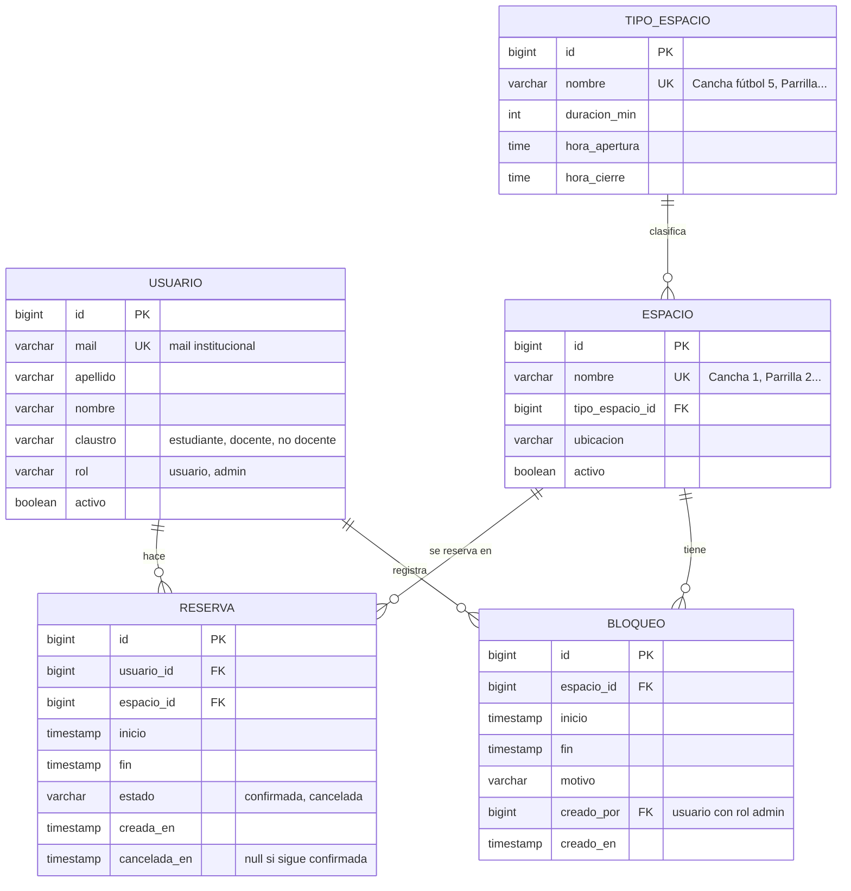

# Diagrama Entidad-Relación

## Relaciones y cardinalidades

| relación | cardinalidad | lectura |
|---|---|---|
| USUARIO hace RESERVA | 1 a N | un usuario puede tener muchas reservas (o ninguna); cada reserva es de un solo usuario |
| ESPACIO se reserva en RESERVA | 1 a N | un espacio tiene muchas reservas; cada reserva es de un solo espacio |
| TIPO_ESPACIO clasifica ESPACIO | 1 a N | un tipo agrupa varios espacios; cada espacio es de un solo tipo |
| ESPACIO tiene BLOQUEO | 1 a N | un espacio puede tener varios bloqueos por mantenimiento en distintas fechas |
| USUARIO registra BLOQUEO | 1 a N | cada bloqueo lo carga un admin |

## Restricciones que no se ven en el diagrama

Todas están implementadas en [`modelo_relacional.sql`](../database/modelo_relacional.sql)
y probadas en [`pruebas_restricciones.sql`](../database/pruebas_restricciones.sql)
(salida en [`pruebas_restricciones_salida.txt`](pruebas_restricciones_salida.txt)).

| regla | cómo la garantiza la base |
|---|---|
| Dos reservas **confirmadas** del mismo espacio no se superponen | `EXCLUDE USING gist` sobre `(espacio_id, tsrange(inicio, fin))` |
| Dos bloqueos del mismo espacio no se superponen | `EXCLUDE USING gist`, igual que reservas |
| `fin` es posterior a `inicio`, en reservas y bloqueos | `CHECK` |
| `cancelada_en` tiene valor si y solo si `estado = 'CANCELADA'` | `CHECK` |
| El mail es institucional y no se repite | `CHECK` con expresión regular y `UNIQUE` |
| La reserva dura lo que indica el tipo y cae dentro de su horario | trigger `validar_reserva` |
| No se reserva un espacio inactivo ni uno bloqueado en ese horario | trigger `validar_reserva` |
| Solo un admin crea bloqueos | trigger `validar_bloqueo` |
| No queda una reserva futura confirmada dentro de un bloqueo | trigger `validar_bloqueo` |
| No se borran espacios ni usuarios con reservas | `FOREIGN KEY ... ON DELETE RESTRICT` |

**Decisión sobre los bloqueos:** si un admin bloquea un horario con reservas
confirmadas, esas reservas se cancelan. El backend las cancela y crea el bloqueo
en la misma transacción, y registra el evento en el historial de cada usuario.
La base rechaza el bloqueo si quedara alguna reserva confirmada adentro.
