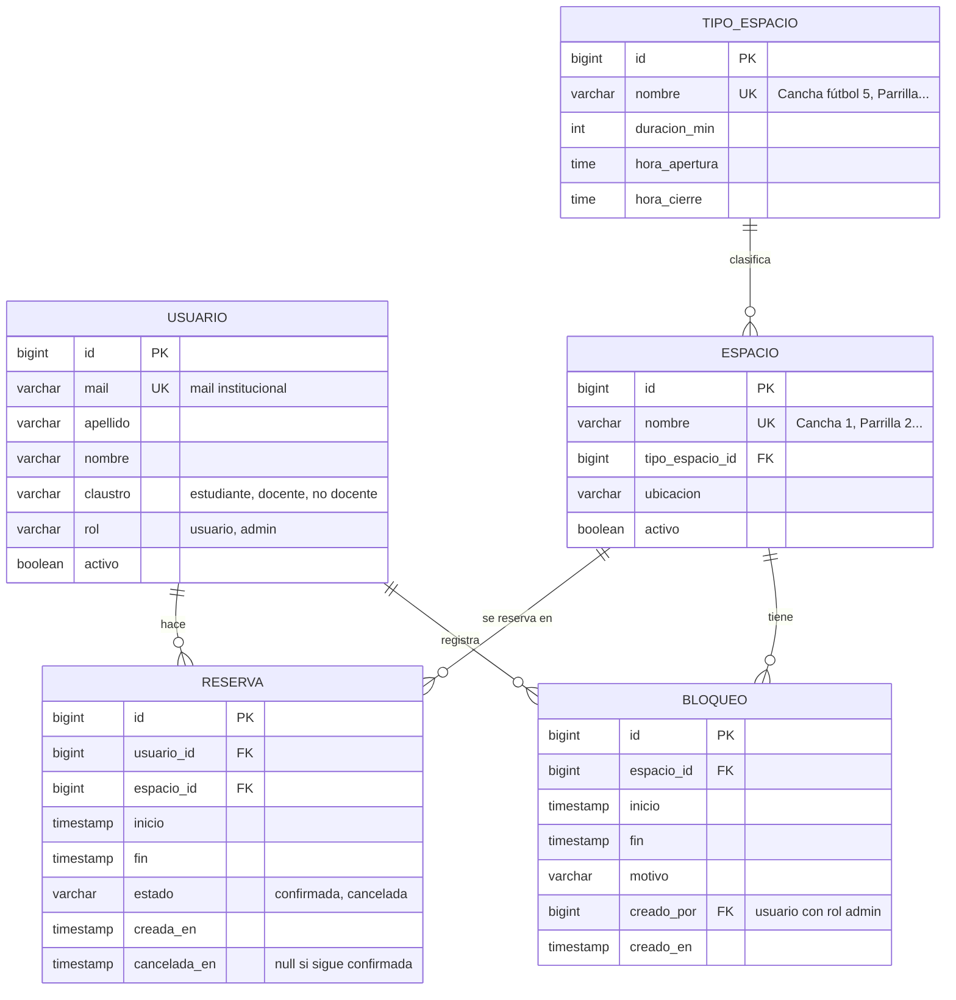

# Diagrama Entidad-Relación

## Relaciones y cardinalidades

| relación | cardinalidad | lectura |
|---|---|---|
| USUARIO hace RESERVA | 1 a N | un usuario puede tener muchas reservas (o ninguna); cada reserva es de un solo usuario |
| ESPACIO se reserva en RESERVA | 1 a N | un espacio tiene muchas reservas; cada reserva es de un solo espacio |
| TIPO_ESPACIO clasifica ESPACIO | 1 a N | un tipo agrupa varios espacios; cada espacio es de un solo tipo |
| ESPACIO tiene BLOQUEO | 1 a N | un espacio puede tener varios bloqueos por mantenimiento en distintas fechas |
| USUARIO registra BLOQUEO | 1 a N | cada bloqueo lo carga un admin |

## Restricciones que no se ven en el diagrama

- Dos reservas **confirmadas** del mismo espacio no pueden superponerse en el
  tiempo. Lo garantiza la base, no el backend.
- `fin` tiene que ser posterior a `inicio`, en reservas y en bloqueos.
- La reserva tiene que caer dentro del horario del tipo de espacio y durar lo que
  indica `duracion_min`.
- No se puede reservar un espacio inactivo ni uno con un bloqueo en ese horario.
- `cancelada_en` tiene valor solo si `estado = 'cancelada'`.
